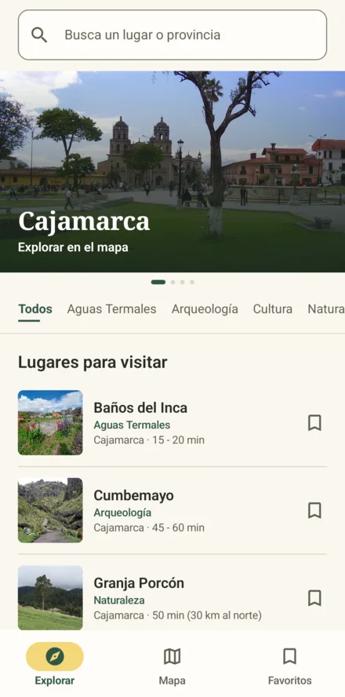
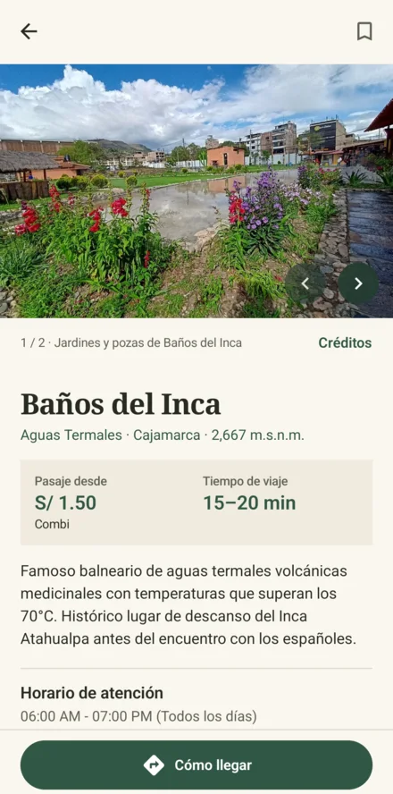
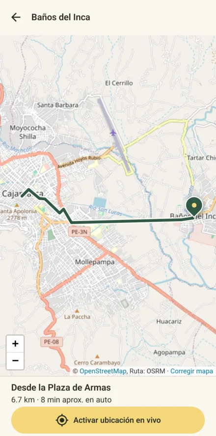

<div align="center">
  
  <h1>CajamApp</h1>
  <p>Guía turística de Cajamarca, Perú, para Android.</p>
  <p><a href="https://github.com/richardmalca/CajamApp/releases/latest">Descargar la última versión</a></p>
</div>

CajamApp reúne **18 destinos de Cajamarca** para descubrir qué visitar, cuánto cuesta llegar y cómo organizar el recorrido. Las fichas incluyen fotografías, horarios, tarifas de referencia, transporte y recomendaciones locales.

<p align="center">
  
  
  
</p>

## Explorar Cajamarca

- **Explorar** permite buscar por nombre o provincia y filtrar por categoría. El carrusel destaca lugares para visitar.
- **Fichas de viaje** muestran galerías con créditos, pasajes y tiempos estimados, horarios, tarifas de ingreso y consejos.
- **Cómo llegar** dibuja una ruta en auto desde la Plaza de Armas. El seguimiento GPS es opcional y permite recalcular desde la ubicación actual.
- **Favoritos** guarda los lugares en el teléfono. Puedes consultar el catálogo y las fotos incluidas en el APK sin conexión.

Los montos y tiempos son orientativos. Las fotos en línea, el mapa base y el cálculo de rutas requieren internet. Las fichas de Cumbico, Pampa de la Culebra y Condorcaga identifican sus fotografías como imágenes del entorno.

## Instalar

1. Abre [Releases](https://github.com/richardmalca/CajamApp/releases) y descarga `CajamApp-1.0.0.apk`.
2. Abre el APK en un dispositivo con **Android 7.0 o posterior**. Si Android lo solicita, autoriza la instalación desde la app con la que abriste el archivo.
3. El archivo `CajamApp-1.0.0.sha256` contiene la suma de verificación del APK.

## Compilar desde el código

Se necesita **JDK 21** y **Android SDK 35**. Puedes abrir el repositorio en Android Studio o compilar desde PowerShell.

```powershell
.\gradlew.bat :app:assembleDebug :app:lintDebug
adb install -r .\app\build\outputs\apk\debug\app-debug.apk
```

La app está hecha con **Kotlin**, **Jetpack Compose** y **Room**. El mapa usa [Leaflet](https://leafletjs.com/), cartografía de [OpenStreetMap](https://www.openstreetmap.org/copyright) y rutas de [OSRM](https://routing.openstreetmap.de/). Al recalcular desde tu ubicación, el punto de partida se envía al servicio de rutas.

## Créditos de fotografía

Las fotografías empaquetadas se redimensionaron o convirtieron a WebP. El recorte en pantalla se ajusta al tamaño de cada vista. Las fotos de Combayo tienen licencia para uso no comercial. Cada ficha muestra los créditos de la foto activa.

### Fotos incluidas en el APK

- [Jardines y pozas de Baños del Inca](https://commons.wikimedia.org/wiki/File:Aguas_termales_-_Ba%C3%B1os_del_Inca.jpg), José Manuel Pacuri Sullón. [Licencia](https://creativecommons.org/licenses/by-sa/4.0/).
- [Aguas termales del complejo](https://commons.wikimedia.org/wiki/File:Aguas_sulforicas_termales_-_Ba%C3%B1os_del_Inca.jpg), José Manuel Pacuri Sullón. [Licencia](https://creativecommons.org/licenses/by-sa/4.0/).
- [Formaciones rocosas de Cumbemayo](https://commons.wikimedia.org/wiki/File:Cumbemayo_Cajamarca.jpg), Tadd y Debbie Ottman. [Licencia](https://creativecommons.org/licenses/by/2.0/).
- [Canal tallado en roca](https://commons.wikimedia.org/wiki/File:Canal_Cumbemayo.jpg), EnriqueGuia. [Licencia](https://creativecommons.org/licenses/by-sa/4.0/).
- [Nichos del conjunto arqueológico](https://commons.wikimedia.org/wiki/File:Las_Ventanillas_de_Otuzco.jpg), Elisolidum. [Licencia](https://creativecommons.org/licenses/by-sa/4.0/).
- [Vista panorámica de las Ventanillas de Otuzco](https://commons.wikimedia.org/wiki/File:Ventanillas_de_Otuzco.jpg), Daniel Maza. [Licencia](https://creativecommons.org/licenses/by-sa/4.0/).
- [Vista del Cuarto del Rescate](https://commons.wikimedia.org/wiki/File:Turistas_visitando_el_Cuarto_del_Rescate_-_Cajamarca.jpg), Polmartin14+. [Licencia](https://creativecommons.org/licenses/by-sa/4.0/).
- [Interior del Cuarto del Rescate](https://commons.wikimedia.org/wiki/File:Cajamarca_-_el_cuarto_del_rescate.jpg), Hellcome. [Licencia](https://creativecommons.org/publicdomain/mark/1.0/).
- [Paisaje de Granja Porcón](https://commons.wikimedia.org/wiki/File:Granja_Porc%C3%B3n_-_View.jpg), AgainErick. [Licencia](https://creativecommons.org/licenses/by-sa/4.0/).
- [Vicuñas en Granja Porcón](https://commons.wikimedia.org/wiki/File:Granja_Porc%C3%B3n_-_View_with_vicu%C3%B1as.jpg), AgainErick. [Licencia](https://creativecommons.org/licenses/by-sa/4.0/).
- [Escalinata hacia la capilla de Fátima](https://commons.wikimedia.org/wiki/File:Escales_que_pugen_al_cerro_de_Santa_Apolonia_amb_la_capella_de_Nuestra_Se%C3%B1ora_de_F%C3%A1tima_a_dalt.jpg), Pitxiquin. [Licencia](https://creativecommons.org/licenses/by-sa/4.0/).
- [Vista de Cajamarca desde el cerro](https://commons.wikimedia.org/wiki/File:Vista_panor%C3%A0mica_de_Cajamarca_des_del_Cerro_de_Santa_Apolonia03.jpg), Pitxiquin. [Licencia](https://creativecommons.org/licenses/by-sa/4.0/).
- [Nichos funerarios de Combayo](https://global-geography.org/af/Geography/America/Peru/Pictures/Cajamarca/Ventanillas_de_Combayo_4), Gerhard Huber. [Licencia](https://creativecommons.org/licenses/by-nc/4.0/).
- [Pared rocosa de las Ventanillas de Combayo](https://global-geography.org/af/Geography/America/Peru/Pictures/Cajamarca/Ventanillas_de_Combayo_3), Gerhard Huber. [Licencia](https://creativecommons.org/licenses/by-nc/4.0/).
- [Laguna San Nicolás, Namora](https://commons.wikimedia.org/wiki/File:Laguna_San_Nicol%C3%A1s_-_panoramio.jpg), cesquisa. [Licencia](https://creativecommons.org/licenses/by-sa/4.0/).
- [Panorámica del sitio arqueológico](https://commons.wikimedia.org/wiki/File:Panor%C3%A0mica_de_les_ru%C3%AFnes_de_Kuntur_Wasi.jpg), Pitxiquin. [Licencia](https://creativecommons.org/licenses/by-sa/4.0/).
- [Muros del complejo Kuntur Wasi](https://commons.wikimedia.org/wiki/File:Muros_de_Kuntur_Wasi.jpg), Jorge.floresparedes. [Licencia](https://creativecommons.org/licenses/by-sa/4.0/).
- [Hacienda La Colpa](https://commons.wikimedia.org/wiki/File:HACIENDA_LA_COLPA_08.jpg), Enrique Jara. [Licencia](https://creativecommons.org/licenses/by-sa/4.0/).
- [Vista de Hacienda La Colpa](https://commons.wikimedia.org/wiki/File:HACIENDA_LA_COLPA_01.jpg), Enrique Jara. [Licencia](https://creativecommons.org/licenses/by-sa/4.0/).
- [Bosques del Parque Nacional Cutervo](https://commons.wikimedia.org/wiki/File:Forests_at_Cutervo_National_Park.jpg), Michael O. Dillon. [Licencia](https://creativecommons.org/licenses/by-sa/4.0/).
- [Relieve del parque y cerro Pabellón](https://commons.wikimedia.org/wiki/File:Relieve_callayujano%2C_al_fondo_el_dominante_cerro_Pabell%C3%B3n..jpg), User:Braxdocument. [Licencia](https://creativecommons.org/licenses/by-sa/4.0/).
- [Riachuelo del Parque Nacional Cutervo](https://commons.wikimedia.org/wiki/File:Riachuelo_del_Parque_Nacional_de_Cutervo.jpg), Manuelriverscix. [Licencia](https://creativecommons.org/licenses/by-sa/4.0/).
- [Conjunto Monumental Belén](https://commons.wikimedia.org/wiki/File:Cajamarca_ConjuntoMonumental1.JPG), Catatine. [Licencia](https://creativecommons.org/licenses/by-sa/4.0/).
- [Antiguo hospital de mujeres de Belén](https://commons.wikimedia.org/wiki/File:Cajamarca_Bel%C3%A9n_HospitalMujeres.JPG), Catatine. [Licencia](https://creativecommons.org/licenses/by-sa/4.0/).
- [Plaza de Armas de Cajamarca](https://commons.wikimedia.org/wiki/File:Cajamarca.JPG), Calebperu. [Licencia](https://creativecommons.org/licenses/by/3.0/).

- [Otra vista de la laguna San Nicolás](https://commons.wikimedia.org/wiki/File:Laguna_San_Nicol%C3%A1s_-_panoramio_(2).jpg), cesquisa. [Licencia](https://creativecommons.org/licenses/by/3.0/).

### Fotos consultadas en línea

- [Ruta hacia Pampa de la Culebra (entorno)](https://es.wikiloc.com/rutas-mountain-bike/los-banos-del-inca-pampa-de-la-culebra-55189052), Wikiloc · ruta Los Baños del Inca – Pampa de La Culebra.
- [Interior del Santuario de Polloc](https://www.infoans.org/sezioni/notizie/item/7960-peru-l-eredita-artistica-di-don-ugo-de-censi-continua-a-battere-in-ogni-angolo-del-paese), Agencia Info Salesiana.
- [Mosaicos del santuario](https://www.infoans.org/sezioni/notizie/item/7960-peru-l-eredita-artistica-di-don-ugo-de-censi-continua-a-battere-in-ogni-angolo-del-paese), Agencia Info Salesiana.
- [Soldados de piedra de Huangashanga, Huasmín](https://destinosperuanos.wordpress.com/2014/12/15/huasmin/), Destinos Peruanos.
- [Complejo termal de Chancaybaños](https://consultasenlinea.mincetur.gob.pe/fichaInventario/index.aspx?cod_Ficha=2146), Inventario Nacional de Recursos Turísticos · MINCETUR.
- [Piscinas del complejo termal](https://consultasenlinea.mincetur.gob.pe/fichaInventario/index.aspx?cod_Ficha=2146), Inventario Nacional de Recursos Turísticos · MINCETUR.
- [Cerro Condorcaga, Chuyabamba (entorno)](https://destino.regioncajamarca.gob.pe/prv/0604), Gobierno Regional de Cajamarca.
- [Comunidad de Cumbico, Magdalena (entorno)](https://www.diariogrupopanorama.com/inician-construccion-de-qocha-agua-negra/), Diario Grupo Panorama.
